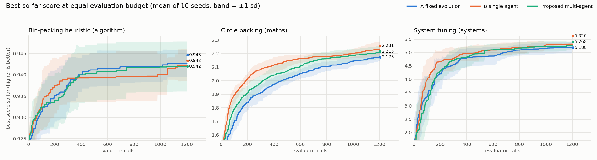
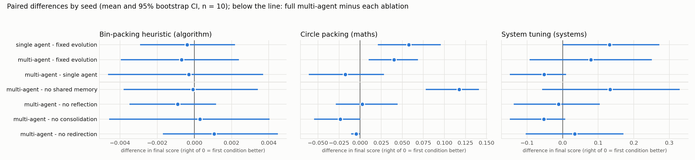

# CORAL-style autonomous multi-agent evolution: implementation and experiments

Implementation of the research proposal **"CORAL: Towards Autonomous Multi-Agent Evolution for
Open-Ended Discovery"** (JK Nivine Allan Raj, S Rithika, Neesha), which is inspired by
Qu et al., *CORAL*, arXiv:2604.01658.

The proposal asks whether agents that control their own search (what to retrieve, what to try,
what to remember) and share a persistent memory do better than a fixed evolutionary pipeline
*at the same evaluation budget*. This repository is the experimental platform the proposal
describes, plus a complete run of its experiment.

- Three conditions: **A** fixed evolutionary search, **B** autonomous single agent,
  **Proposed** four asynchronous agents with shared memory.
- Four ablations of the proposed approach (no shared memory, no reflection, no consolidation,
  no redirection).
- Three tasks, one per domain named in the proposal: mathematical discovery, algorithm
  optimisation, system optimisation.
- Every metric in proposal section 3.5, logged per evaluation, with paired statistics.

## Read this first: what drives the agents

In CORAL the agents are LLMs. Here the agent's decisions go through a `policy` object with two
implementations:

| Policy | What decides | Status |
|---|---|---|
| `HeuristicPolicy` (default) | A seeded contextual Thompson-sampling rule that reads the same memory an LLM agent would. No network, no cost, exactly reproducible. | Used for **all results in this repository**. |
| `LLMPolicy` (`--policy llm`) | A Claude model chooses the parent attempt, operator and step size from a prompt containing the evaluator feedback, notes and skills, and writes a lesson at each heartbeat. | Implemented and unit-tested against a stand-in client. **Not run against the live API**: no API key was available when the results were produced. |

So the reported numbers measure the CORAL *architecture* (persistent shared memory, asynchronous
agents, heartbeat reflection, consolidation, redirection) with a rule-based controller. They are
not a measurement of LLM agents and should not be read as a replication of the paper's results.

## How the proposal maps to the code

| Proposal section | Where |
|---|---|
| 3.1 Problem x, candidate y, evaluator E(x, y) = (s, f) | `coral/tasks/base.py`, `coral/evaluator.py` |
| 3.2.1 Persistent memory: attempts, notes, skills | `coral/memory.py` |
| 3.2.2 Asynchronous agents, private workspaces, shared memory as the only channel | `coral/agent.py`, event-queue scheduler in `coral/runner.py` |
| 3.2.3 Heartbeat: reflection, consolidation, redirection | `CoralAgent.heartbeat / reflect / redirect`, `SharedMemory.consolidate` |
| 3.2.4 Evaluator and feedback, same evaluator for all conditions, budget, time limit | `coral/evaluator.py` |
| 3.4 Baseline A, Baseline B, proposed approach, ablations | `coral/baseline.py`, `coral/config.py` |
| 3.5 Evaluation criteria | summary fields in `coral/runner.py`, tables in `analyze_results.py` |
| 3.7 Logging and paired statistics | `results/evaluations.csv.gz`, `coral/stats.py` |

### The three tasks

| Task | Domain | Candidate | Score (maximised) | Evaluator feedback |
|---|---|---|---|---|
| `circle_packing` | mathematical discovery | centres of 26 circles in the unit square | sum of radii; the evaluator assigns the radii so every candidate is a valid packing | which circles are smallest |
| `bin_packing` | algorithm optimisation | 8 weights of a priority function for online bin packing | lower bound / bins used, averaged over 8 fixed instances | too many bins opened, loose bins, tight |
| `system_tuning` | system optimisation | 10 configuration knobs of a simulated request-serving system | goodput within the latency objective minus running cost | binding bottleneck: CPU, I/O, network, memory, latency, queue drops |

`system_tuning` is an analytic simulator written for this project, not a real system.

### What differs between conditions

All conditions generate candidates with the same seven variation operators
(`coral/operators.py`) and call the same evaluator with the same budget. The difference is
control:

- **A, fixed evolution**: tournament selection, operator drawn uniformly, fixed step size,
  replace-worst. Every decision is a preset rule.
- **B and Proposed, autonomous agents**: each agent decides which attempt to build on (its own
  or one retrieved from memory), which operator to use given the evaluator's diagnosis and the
  notes and skills in memory, and adapts its step size. It skips candidates memory has already
  seen. Every 25 of its own evaluations a heartbeat fires: it writes notes (reflection), merges
  notes and promotes recurring successes to skills (consolidation), and changes what it is
  working on if it has gone 50 evaluations without a personal best (redirection).

One modelling assumption matters for the ablations: an agent's private context is cleared at
every heartbeat, as a long-running LLM agent's context is truncated. Anything not written to
memory is lost.

## Install

Python 3.10 or newer.

```bash
pip install -r requirements.txt
```

Only for the optional LLM policy:

```bash
pip install anthropic
```

## Run

Check the installation (13 tests, a few seconds):

```bash
python -m unittest discover -s tests -v
```

One run with everything kept on disk (shared memory, per-agent workspaces, best solution):

```bash
python run_demo.py --task circle_packing --config multi_agent --seed 0
```

Output goes to `runs/<task>_<config>_seed<N>/`: `memory/attempts.jsonl`, `memory/notes.jsonl`,
`memory/skills.json`, `workspace/agent_<i>/journal.md` (the agent's reflections and
redirections) and `best_solution.json`. `--task` is one of `circle_packing`, `bin_packing`,
`system_tuning`; `--config` is one of `fixed_evo`, `single_agent`, `multi_agent`,
`abl_no_shared_memory`, `abl_no_reflection`, `abl_no_consolidation`, `abl_no_redirection`.

With a Claude model making the decisions (needs `ANTHROPIC_API_KEY`; every decision is an API
call, so start small):

```bash
python run_demo.py --policy llm --budget 60 --llm-every 5
```

## Reproduce the results

```bash
python run_experiments.py
```

```bash
python analyze_results.py
```

The first command runs 3 tasks x 7 conditions x 10 seeds at 1,200 evaluator calls each (210
runs, a few minutes on a 16-core machine) and writes `results/summary.csv`, `results/curves.npz`
and `results/evaluations.csv.gz`. The second writes the tables, the figures and
`results/RESULTS.md`. Runs are deterministic given (task, condition, seed), so scores reproduce
exactly; only the runtime column varies. `python run_experiments.py --quick` runs a
20-second version of the grid.

## Results

Full tables: [results/RESULTS.md](results/RESULTS.md). These are from the first complete run of
the grid; no setting was changed after seeing the results.



| Task | A fixed evolution | B single agent | Proposed multi-agent (4) |
|---|---|---|---|
| Circle packing, sum of radii | 2.173 ± 0.029 | **2.231 ± 0.058** | 2.213 ± 0.046 |
| Bin-packing heuristic, bound / bins | 0.943 ± 0.004 | 0.942 ± 0.003 | 0.942 ± 0.006 |
| System tuning, net goodput / 10^4 | 5.189 ± 0.220 | **5.320 ± 0.015** | 5.268 ± 0.145 |

Mean ± standard deviation of the final score over 10 seeds, 1,200 evaluations per run.



What the experiment says about the proposal's hypotheses, with n = 10 seeds per cell:

- **H1 (autonomous single agent beats fixed search): partly supported.** On circle packing the
  single agent finished 0.058 higher (95% CI 0.021 to 0.096, p = 0.023, Holm-adjusted 0.14) and
  reached the baseline's median final score 223 evaluations sooner (CI 38 to 415). On system
  tuning it was 0.13 higher and far more consistent (sd 0.015 against 0.220), but the difference
  is not significant (p = 0.25). On bin packing there is no difference. Nothing survives
  correction for multiple comparisons.
- **H2 (multiple agents add value over one): not supported.** The four-agent condition was
  never better than the single agent in final score (differences within noise on all three
  tasks). What it does buy is parallelism: its busiest agent performed about 340 evaluations
  instead of 1,200 for a similar score.
- **H3 (memory and heartbeat reflection help): supported for shared memory only.** Removing
  shared memory cost 0.117 on circle packing (CI 0.078 to 0.141, Holm-adjusted p = 0.027), the
  one effect in the study that survives correction. Removing reflection or redirection changed
  nothing detectable, and the variant without consolidation scored slightly *higher* on two
  tasks (not significant). With this controller, notes and skills are used constantly but do
  not pay for themselves.
- **H4 (benefits are task-dependent and can be cancelled by overhead): supported.** There is no
  benefit at all on bin packing, where the score moves in coarse steps, and the agent conditions
  make about 4,800 memory reads per run and take roughly twice the wall-clock time of the
  baseline on the cheapest task.

The bin-packing runtimes in Table 1 were measured with 15 runs in parallel and are inflated by
contention; compare runtimes within a task only.

## Limitations

- **No LLM in the reported results**, as explained above. The LLM policy is untested against
  the live API.
- **Candidates are parameter vectors, not programs.** CORAL agents write code. This keeps the
  evaluator safe without sandboxing, but it means the evaluator's time limit is checked after
  each call rather than enforced by isolation, and it narrows what a "skill" can be: here a
  skill is "under diagnosis T use operator O at step size S", not a reusable script.
- **Asynchrony is simulated.** Agents interleave through a seeded event queue in one process,
  which makes runs reproducible but means wall-clock time does not show a parallel speed-up.
- **Small sample and modest budget.** Ten seeds and 1,200 evaluations; several comparisons are
  underpowered, and the scores are far from the best known values (about 2.635 for 26 circles).
- **Synthetic system task.** The system-tuning landscape is an analytic model.
- **Token cost is not measured**, since the offline policy makes no API calls. Cost is reported
  as memory accesses, runtime and evaluations per worker.
- On Windows, `run_demo.py` creates nested folders; in a very deep parent folder this can exceed
  the 260-character path limit. Use `--out` with a short path if that happens.

## Repository layout

```
coral/
  tasks/            the three tasks and the task interface
  evaluator.py      budgeted evaluator with feedback and logging
  operators.py      variation operators shared by all conditions
  memory.py         persistent shared memory: attempts, notes, skills
  policy.py         offline decision policy
  llm_policy.py     Claude-driven decision policy (optional)
  agent.py          autonomous agent with heartbeat
  baseline.py       Baseline A, fixed evolutionary search
  config.py         conditions and ablations
  runner.py         one run: scheduler, budget, metrics
  stats.py          paired statistics
run_demo.py         one run, artifacts kept on disk
run_experiments.py  the full grid
analyze_results.py  tables, figures, results/RESULTS.md
tests/              unit tests
results/            data, tables and figures from the reported run
```

## References

1. A. Qu et al., "CORAL: Towards Autonomous Multi-Agent Evolution for Open-Ended Discovery," arXiv:2604.01658, 2026.
2. B. Romera-Paredes et al., "Mathematical discoveries from program search with large language models," Nature 625, 2024.
3. A. Novikov et al., "AlphaEvolve: A Coding Agent for Scientific and Algorithmic Discovery," arXiv:2506.13131, 2025.
4. N. Shinn et al., "Reflexion: Language Agents with Verbal Reinforcement Learning," NeurIPS 2023.
5. S. Yao et al., "ReAct: Synergizing Reasoning and Acting in Language Models," ICLR 2023.
