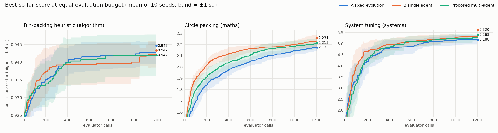
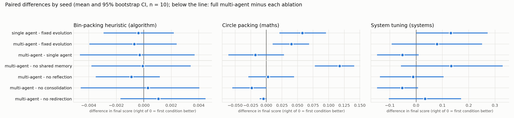

# Results

Generated by `analyze_results.py` from `results/summary.csv` and `results/curves.npz`.
Grid: 3 tasks x 7 conditions x 10 seeds, 1200 evaluator calls per run.
All scores are maximised. Agent conditions use the offline heuristic policy (no LLM calls).

## Table 1. Main metrics

"Evals to target" is the number of evaluator calls needed to reach the median final score of
Baseline A on that task (targets: bin_packing 0.9434, circle_packing 2.1849, system_tuning 5.3248). Runs that never
reach it are counted at the full budget. "Evals on busiest worker" is the number of evaluations
the busiest agent performed: with four agents the same budget is spread over four workers.

| task | condition | final best (mean ± sd) | best seed | improvements / run | evals to target (median) | reached target | runtime s | evals on busiest worker | memory reads |
|---|---|---|---|---|---|---|---|---|---|
| bin_packing | A fixed evolution | 0.9426 ± 0.0031 | 0.9463 | 8.3 | 769 | 6/10 | 39.49 | 1200 | 0 |
| bin_packing | B single agent | 0.9422 ± 0.0038 | 0.9501 | 7.3 | 1200 | 4/10 | 39.65 | 1200 | 4726 |
| bin_packing | Proposed multi-agent | 0.9419 ± 0.0059 | 0.9501 | 8.4 | 1200 | 4/10 | 39.68 | 351 | 4747 |
| bin_packing | no shared memory | 0.9420 ± 0.0036 | 0.9463 | 8.6 | 1200 | 3/10 | 39.63 | 350 | 4736 |
| bin_packing | no reflection | 0.9428 ± 0.0066 | 0.9501 | 8.7 | 834 | 5/10 | 39.44 | 351 | 2387 |
| bin_packing | no consolidation | 0.9416 ± 0.0044 | 0.9467 | 9.0 | 1200 | 4/10 | 39.33 | 351 | 3569 |
| bin_packing | no redirection | 0.9409 ± 0.0087 | 0.9501 | 7.9 | 625 | 6/10 | 33.37 | 350 | 4784 |
| circle_packing | A fixed evolution | 2.1731 ± 0.0293 | 2.2079 | 39.1 | 1170 | 5/10 | 1.81 | 1200 | 0 |
| circle_packing | B single agent | 2.2307 ± 0.0580 | 2.3375 | 92.8 | 959 | 7/10 | 1.91 | 1200 | 4883 |
| circle_packing | Proposed multi-agent | 2.2132 ± 0.0456 | 2.2755 | 52.3 | 975 | 9/10 | 1.91 | 334 | 4820 |
| circle_packing | no shared memory | 2.0958 ± 0.0333 | 2.1560 | 43.5 | 1200 | 0/10 | 2.01 | 334 | 4777 |
| circle_packing | no reflection | 2.2106 ± 0.0585 | 2.2814 | 49.9 | 925 | 7/10 | 1.95 | 334 | 2386 |
| circle_packing | no consolidation | 2.2368 ± 0.0278 | 2.2841 | 50.5 | 831 | 10/10 | 1.98 | 334 | 3579 |
| circle_packing | no redirection | 2.2180 ± 0.0460 | 2.2931 | 52.7 | 971 | 9/10 | 1.92 | 334 | 4814 |
| system_tuning | A fixed evolution | 5.1885 ± 0.2195 | 5.3248 | 29.4 | 953 | 7/10 | 0.17 | 1200 | 0 |
| system_tuning | B single agent | 5.3200 ± 0.0152 | 5.3248 | 38.8 | 629 | 9/10 | 0.31 | 1200 | 4854 |
| system_tuning | Proposed multi-agent | 5.2680 ± 0.1451 | 5.3248 | 32.1 | 675 | 8/10 | 0.33 | 352 | 4832 |
| system_tuning | no shared memory | 5.1350 ± 0.2815 | 5.3248 | 27.4 | 1039 | 6/10 | 0.33 | 352 | 4835 |
| system_tuning | no reflection | 5.2790 ± 0.1447 | 5.3248 | 28.2 | 598 | 9/10 | 0.31 | 352 | 2471 |
| system_tuning | no consolidation | 5.3211 ± 0.0116 | 5.3248 | 32.1 | 852 | 9/10 | 0.36 | 352 | 3660 |
| system_tuning | no redirection | 5.2342 ± 0.1909 | 5.3248 | 31.6 | 671 | 8/10 | 0.30 | 352 | 4870 |

## Table 2. Paired comparisons of the final score

Pairs share task and seed. Difference = first condition minus second. CI: bootstrap of the mean
(10,000 resamples). d_z: Cohen's d for paired samples. p: two-sided exact sign-flip permutation
test; Holm-adjusted within each task.

| task | comparison | tests | mean diff [95% CI] | d_z | W/T/L | p | p (Holm) |
|---|---|---|---|---|---|---|---|
| bin_packing | single agent - fixed evolution | H1 | -0.0004 [-0.0029, +0.0022] | -0.09 | 4/1/5 | 0.758 | 1.000 |
| bin_packing | multi-agent - fixed evolution | H1/H2 | -0.0007 [-0.0040, +0.0024] | -0.13 | 5/1/4 | 0.715 | 1.000 |
| bin_packing | multi-agent - single agent | H2 | -0.0003 [-0.0047, +0.0037] | -0.04 | 5/1/4 | 0.934 | 1.000 |
| bin_packing | multi-agent - no shared memory | H3 | -0.0001 [-0.0038, +0.0034] | -0.01 | 6/0/4 | 0.988 | 1.000 |
| bin_packing | multi-agent - no reflection | H3 | -0.0009 [-0.0035, +0.0012] | -0.22 | 5/2/3 | 0.688 | 1.000 |
| bin_packing | multi-agent - no consolidation | H3 | +0.0003 [-0.0046, +0.0040] | +0.04 | 7/0/3 | 0.943 | 1.000 |
| bin_packing | multi-agent - no redirection | H3 | +0.0011 [-0.0017, +0.0045] | +0.20 | 4/4/2 | 0.625 | 1.000 |
| circle_packing | single agent - fixed evolution | H1 | +0.0576 [+0.0211, +0.0957] | +0.91 | 7/0/3 | 0.023 | 0.141 |
| circle_packing | multi-agent - fixed evolution | H1/H2 | +0.0401 [+0.0100, +0.0685] | +0.80 | 8/0/2 | 0.037 | 0.186 |
| circle_packing | multi-agent - single agent | H2 | -0.0175 [-0.0607, +0.0284] | -0.23 | 4/0/6 | 0.473 | 0.945 |
| circle_packing | multi-agent - no shared memory | H3 | +0.1174 [+0.0780, +0.1409] | +1.99 | 9/0/1 | 0.004 | 0.027 |
| circle_packing | multi-agent - no reflection | H3 | +0.0026 [-0.0287, +0.0445] | +0.04 | 3/0/7 | 0.932 | 0.945 |
| circle_packing | multi-agent - no consolidation | H3 | -0.0237 [-0.0545, +0.0001] | -0.51 | 2/0/8 | 0.107 | 0.430 |
| circle_packing | multi-agent - no redirection | H3 | -0.0048 [-0.0108, +0.0000] | -0.50 | 0/7/3 | 0.250 | 0.750 |
| system_tuning | single agent - fixed evolution | H1 | +0.1315 [+0.0000, +0.2717] | +0.59 | 3/6/1 | 0.250 | 1.000 |
| system_tuning | multi-agent - fixed evolution | H1/H2 | +0.0795 [-0.0925, +0.2505] | +0.27 | 3/5/2 | 0.625 | 1.000 |
| system_tuning | multi-agent - single agent | H2 | -0.0520 [-0.1484, +0.0096] | -0.35 | 1/7/2 | 0.500 | 1.000 |
| system_tuning | multi-agent - no shared memory | H3 | +0.1329 [-0.0578, +0.3293] | +0.40 | 4/5/1 | 0.312 | 1.000 |
| system_tuning | multi-agent - no reflection | H3 | -0.0111 [-0.1373, +0.1040] | -0.06 | 1/8/1 | 1.000 | 1.000 |
| system_tuning | multi-agent - no consolidation | H3 | -0.0532 [-0.1484, +0.0074] | -0.36 | 1/7/2 | 0.500 | 1.000 |
| system_tuning | multi-agent - no redirection | H3 | +0.0337 [-0.1036, +0.1710] | +0.14 | 2/7/1 | 1.000 | 1.000 |

## Table 3. Evaluation efficiency against Baseline A

Evaluator calls saved in reaching Baseline A's median final score (positive = the agent
condition got there sooner; censored at the budget).

| task | comparison | evals saved [95% CI] | W/T/L | p |
|---|---|---|---|---|
| bin_packing | single agent - fixed evolution | -204 [-548, +159] | 2/3/5 | 0.328 |
| bin_packing | multi-agent - fixed evolution | -164 [-438, +58] | 3/3/4 | 0.328 |
| circle_packing | single agent - fixed evolution | +223 [+38, +415] | 5/2/3 | 0.070 |
| circle_packing | multi-agent - fixed evolution | +188 [+21, +363] | 6/1/3 | 0.094 |
| system_tuning | single agent - fixed evolution | +214 [-4, +406] | 7/0/3 | 0.084 |
| system_tuning | multi-agent - fixed evolution | +136 [-229, +454] | 7/0/3 | 0.465 |

## Table 4. Knowledge reuse and coordination cost

Means per run. "Success" = the new candidate scored higher than the attempt it was built on.

| task | condition | notes kept | skills | skill uses | skill success | note-informed steps | note-informed success | cross-agent builds | cross-agent success | redirections | duplicates avoided | memory reads | memory writes |
|---|---|---|---|---|---|---|---|---|---|---|---|---|---|
| bin_packing | B single agent | 8.5 | 0.0 | 6.6 | 2% | 1137 | 3% | 0.0 | - | 20.2 | 13.7 | 4726 | 1573 |
| bin_packing | Proposed multi-agent | 9.1 | 0.0 | 10.9 | 2% | 1092 | 2% | 191.0 | 1% | 13.2 | 5.4 | 4747 | 1560 |
| bin_packing | no shared memory | 35.1 | 0.1 | 17.2 | 6% | 1070 | 3% | 0.0 | - | 14.6 | 5.7 | 4736 | 1564 |
| bin_packing | no reflection | 0.0 | 0.0 | 0.0 | - | 0 | - | 227.3 | 1% | 12.8 | 7.7 | 2387 | 1200 |
| bin_packing | no consolidation | 320.4 | 0.0 | 0.0 | - | 1099 | 2% | 201.8 | 1% | 12.5 | 7.5 | 3569 | 1520 |
| bin_packing | no redirection | 7.0 | 0.0 | 14.2 | 2% | 1110 | 1% | 185.7 | 1% | 0.0 | 12.3 | 4784 | 1560 |
| circle_packing | B single agent | 10.4 | 0.8 | 283.6 | 13% | 1155 | 9% | 0.0 | - | 4.5 | 117.6 | 4883 | 1568 |
| circle_packing | Proposed multi-agent | 14.4 | 0.8 | 249.5 | 14% | 1101 | 10% | 179.6 | 9% | 0.6 | 47.4 | 4820 | 1611 |
| circle_packing | no shared memory | 57.1 | 4.0 | 257.6 | 15% | 1072 | 12% | 0.0 | - | 0.8 | 7.9 | 4777 | 1601 |
| circle_packing | no reflection | 0.0 | 0.0 | 0.0 | - | 0 | - | 210.9 | 6% | 0.3 | 0.4 | 2386 | 1200 |
| circle_packing | no consolidation | 388.7 | 0.0 | 0.0 | - | 1103 | 9% | 194.6 | 8% | 0.3 | 0.4 | 3579 | 1588 |
| circle_packing | no redirection | 14.4 | 0.8 | 250.0 | 14% | 1101 | 10% | 171.4 | 10% | 0.0 | 42.5 | 4814 | 1611 |
| system_tuning | B single agent | 16.6 | 0.5 | 56.6 | 13% | 1124 | 5% | 0.0 | - | 16.5 | 132.2 | 4854 | 1630 |
| system_tuning | Proposed multi-agent | 17.2 | 0.4 | 133.1 | 14% | 1085 | 7% | 174.9 | 5% | 9.7 | 88.2 | 4832 | 1629 |
| system_tuning | no shared memory | 70.7 | 2.3 | 120.4 | 14% | 1032 | 9% | 0.0 | - | 5.0 | 78.5 | 4835 | 1633 |
| system_tuning | no reflection | 0.0 | 0.0 | 0.0 | - | 0 | - | 170.8 | 5% | 10.1 | 94.7 | 2471 | 1200 |
| system_tuning | no consolidation | 393.9 | 0.0 | 0.0 | - | 1094 | 6% | 178.0 | 5% | 8.0 | 96.4 | 3660 | 1593 |
| system_tuning | no redirection | 9.5 | 0.0 | 116.6 | 14% | 1105 | 6% | 168.5 | 5% | 0.0 | 98.0 | 4870 | 1613 |

## Reproducibility

Standard deviations across seeds are in Table 1. Re-running a (task, condition, seed) triple
reproduces the same evaluation trace exactly; `tests/test_coral.py` checks this.
